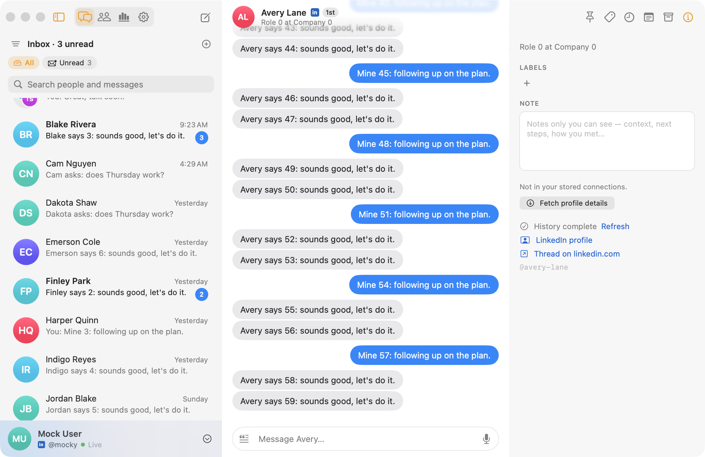
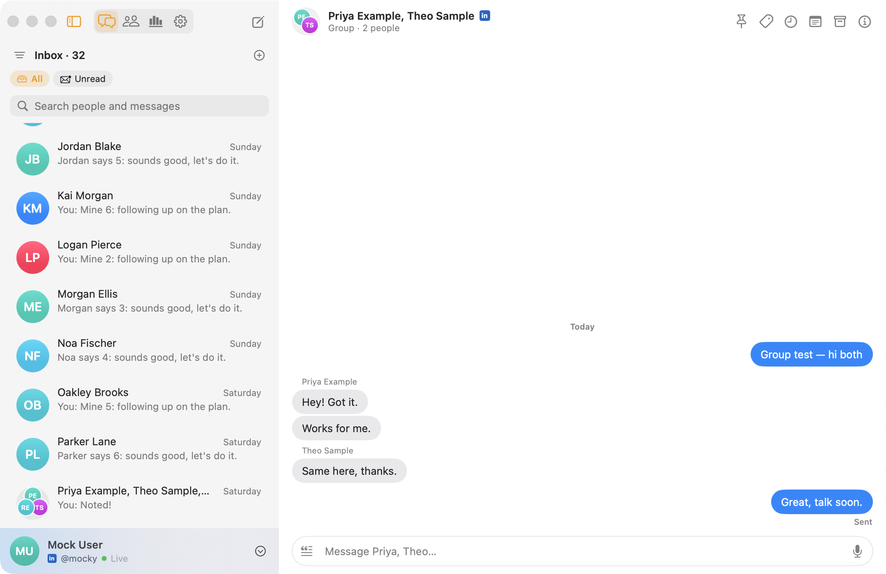
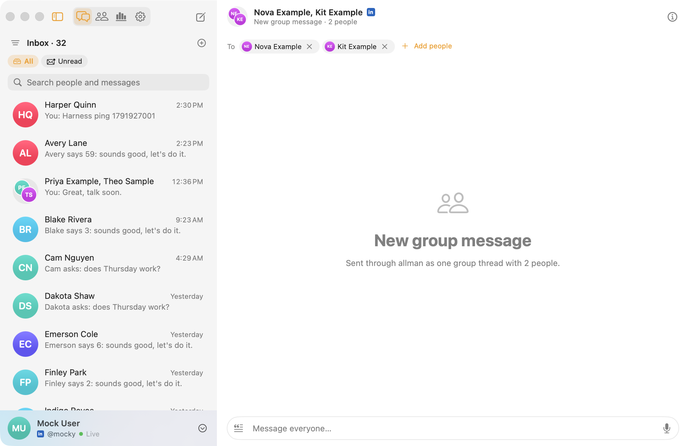
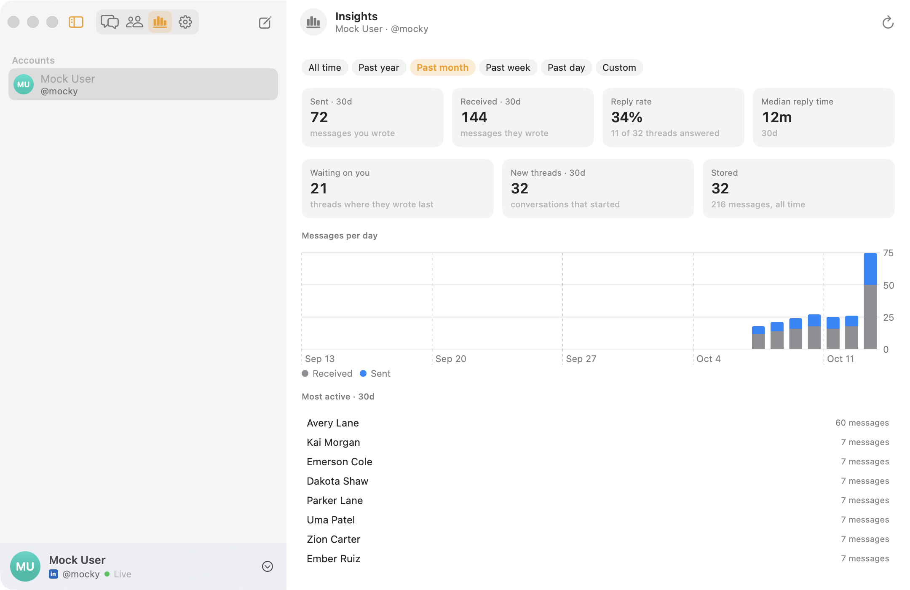
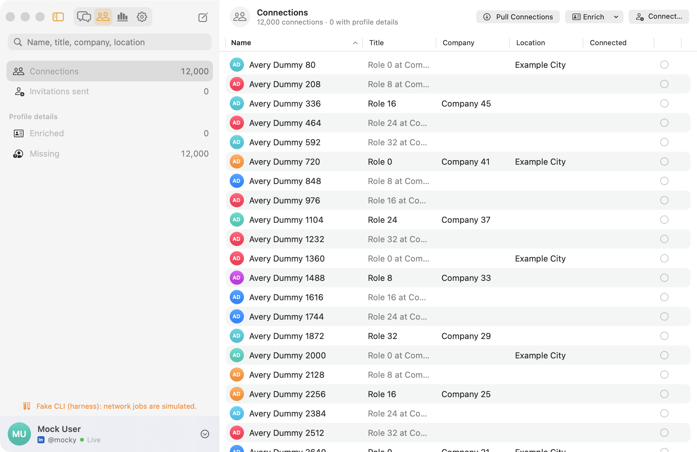

# Allman for Mac

A native LinkedIn inbox for macOS, built on the local-first
[`allman`](https://github.com/tarkaai/allman-cli) CLI. Your messages live in `~/.allman` as
plain files; the app gives them an iMessage-style window, keeps them in sync from the menu bar,
and never talks to LinkedIn except through the CLI.

- **Inbox.** Search people and every message body, pin favorites, filter by unread or by
  label, swipe rows Mail-style, reply with reactions and quotes.
- **Organize.** Labels act as split inboxes, private notes per contact, snooze and reminders,
  archive with undo, saved snippets with placeholders.
- **Groups.** Group threads with sender captions, and new group messages to several people.
- **Network.** Your connections as a sortable table, enrichment and connection requests,
  all driven through the CLI with its rate limits intact.
- **Insights.** Volume, reply rate and median reply time per account, by calendar range.
- **Always on.** A menu bar item keeps `allman listen` running, re-syncs on wake and network
  changes, and posts native notifications with inline reply. Several accounts at once.

| | |
| --- | --- |
|  |  |
|  |  |

*All screenshots are from the app's mock-data test run; no real people appear.*

## Install

Download `Allman-<version>-arm64.zip` from the
[releases page](https://github.com/tarkaai/allman-mac/releases), unzip, move `Allman.app` to
/Applications and launch it. It lives in the menu bar; click the icon for the inbox. Builds are
ad-hoc signed and not notarized, so on first launch right-click **Allman.app → Open**.

Requires macOS 26 on Apple Silicon. The `allman` CLI is embedded; sign in from the app
(Settings → Accounts → Add Account…) and it runs `allman login` for you.

## Docs

- [Using the app](docs/GUIDE.md): the window, inbox organization, Network, Insights,
  accounts and every keyboard shortcut.
- [Development](docs/DEVELOPMENT.md): building, releasing, the fake CLI and mock-data harness,
  and how the app talks to the store and the CLI.
- [UI rules](docs/UI-RULES.md): the window's layout rules and the automated check behind each.

Companion repos: [`allman-cli`](https://github.com/tarkaai/allman-cli) (the CLI this app
embeds) and [`allman-tui`](https://github.com/tarkaai/allman-tui) (the terminal inbox).

## License

MIT — see [LICENSE](./LICENSE). Please read [RESPONSIBLE_USE.md](./RESPONSIBLE_USE.md).
Named, like its siblings, in tribute to [Eric Allman](https://en.wikipedia.org/wiki/Eric_Allman).
